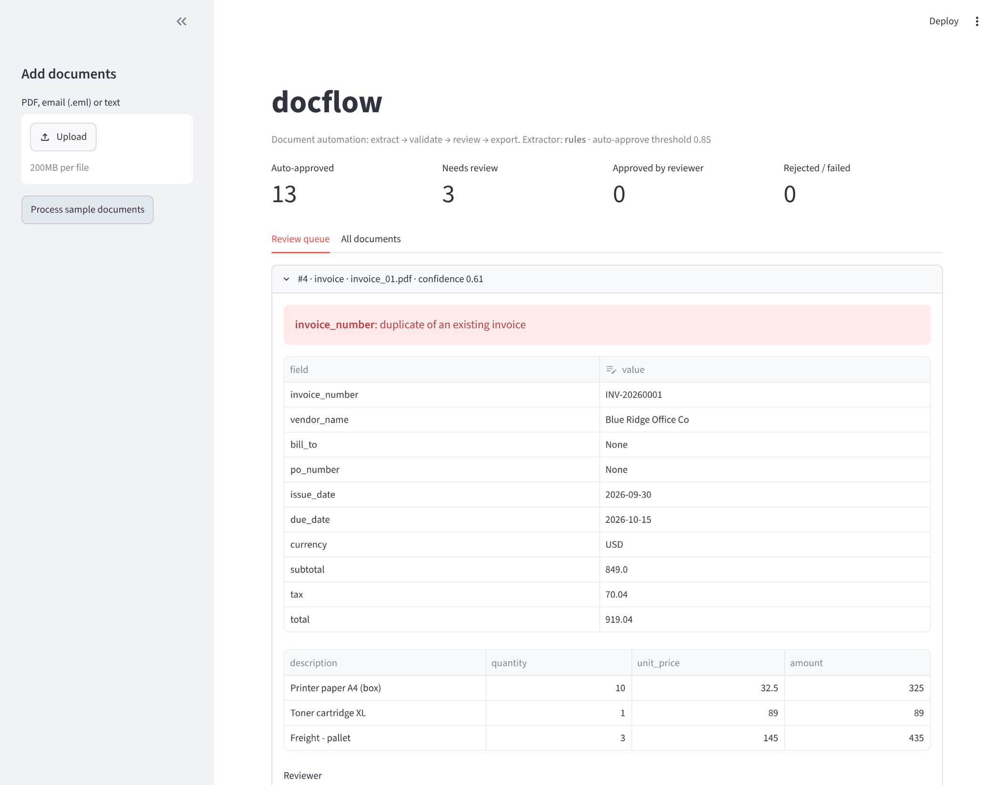
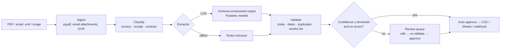

# docflow-agent

**Turn invoices, receipts and contracts into clean, validated data automatically, with a
human in the loop for the ones that need a second look.**

[](https://github.com/faizanreza-cs/docflow-agent/actions/workflows/ci.yml)


Accounts-payable teams still re-type invoices from PDFs and email attachments. docflow reads
the document, extracts typed fields with an LLM (or offline rules), checks the numbers, and
does one of two things:

- **auto-approves** a clean document and exports it to CSV, Google Sheets or a webhook
  (Zapier, Make, n8n, your ERP), or
- **routes it to a review queue** with the exact problem highlighted ("subtotal + tax =
  919.04 but total is 1,019.04", "duplicate of an existing invoice").



## How it works



| Stage | What it does |
|---|---|
| Ingest | PDFs, `.eml` emails (pulls PDF and image attachments), images via optional OCR |
| Extract | LLM with **structured outputs**: the model must return valid `Invoice`, `Receipt` or `ContractTerms` JSON. A regex extractor runs offline with no API key |
| Validate | Line items add up to the subtotal, subtotal + tax = total, due date ≥ issue date, positive totals, approved-vendor list, **duplicate invoice detection** |
| Score and route | Errors and warnings lower confidence. Below the threshold (default 0.85), or with any error, the document goes to review |
| Review | Reviewer edits fields, then the document is **re-validated before approval**, so bad data can't be waved through. Every decision is stored with reviewer and timestamp |
| Export | CSV, webhook (one JSON POST per document), Google Sheets (service account) |

Extracted fields:

- **Invoices:** number, vendor, bill-to, PO, issue and due dates, currency, line items,
  subtotal, tax, total.
- **Receipts:** merchant, date, payment method, items, totals.
- **Contracts:** parties, effective and end dates, auto-renewal, notice period, governing law,
  payment terms, liability cap.

## Quickstart

```bash
git clone https://github.com/faizanreza-cs/docflow-agent && cd docflow-agent
make setup            # uv venv + install
make samples          # 15 synthetic invoices/receipts/contracts + an email with a PDF attachment
docflow run samples/docs --extractor rules --export out/invoices.csv
make ui               # review UI on http://localhost:8501
make api              # REST API on http://localhost:8000/docs
```

Use an LLM extractor:

```bash
export ANTHROPIC_API_KEY=...  DOCFLOW_MODEL=<anthropic model id>
docflow run samples/docs                      # auto-selects the LLM when both are set
# or: pip install 'docflow-agent[openai]'; export OPENAI_API_KEY=... DOCFLOW_OPENAI_MODEL=...
docflow run samples/docs --extractor openai
```

Work the review queue from the CLI:

```bash
docflow review list
docflow review approve 4 --reviewer alice --set total=919.04
docflow review reject 7 --reviewer alice --note "not our vendor"
```

| Setting | Default | Meaning |
|---|---|---|
| `DOCFLOW_PROVIDER` | `auto` | `anthropic`, `openai`, `rules`; `auto` uses the LLM when a key and model are set |
| `DOCFLOW_MODEL` | none | LLM model id |
| `DOCFLOW_REVIEW_THRESHOLD` | `0.85` | confidence needed for auto-approval |
| `DOCFLOW_KNOWN_VENDORS` | none | comma-separated approved vendors; others always go to review |
| `DOCFLOW_API_TOKEN` | none | when set, every API request must send it as `X-API-Key` (set this before exposing the API) |
| `DOCFLOW_DB` | `data/docflow.db` | SQLite review queue and document store |

## Evaluation

`make eval` scores field-level accuracy and routing (did documents with planted errors go to
review?) against ground truth in `samples/truth/`:

| Extractor | Field accuracy | Routing accuracy | Doc-type accuracy |
|---|---|---|---|
| Rules (offline) | 100% | 100% | 100% |

The rules extractor was written against these sample layouts, so 100% here means the
pipeline, validation and routing work end to end. It does **not** predict accuracy on real
vendor documents, which vary much more. That variety is what the LLM extractor is for: run
`make eval-llm`, and add your own documents and truth files to measure it on real data.

## Engineering

- Pydantic schemas double as the LLM's output contract and the validation layer.
- Extractor failures (API errors, refusals) and unreadable files never crash a batch: the
  document is marked `failed` and kept for review.
- Duplicates match regardless of case and spacing, and a flagged duplicate can't be approved
  while the original is approved.
- CSV and Sheets exports neutralise spreadsheet formulas in document text and contain
  invoices only.
- 23 tests: extraction, email attachments, date-format detection, validation rules,
  duplicate detection, review approval with re-validation, formula-safe export, CLI and API.
- ruff, mypy, GitHub Actions CI, Docker image smoke-tested in CI.

```
docflow/
  ingest.py        PDF, email, image → text
  classify.py      document type
  extractors/      rules.py (offline) · llm.py (Anthropic / OpenAI structured outputs)
  validate.py      business rules + confidence score
  pipeline.py      routing
  review.py        SQLite review queue
  exporters.py     CSV · webhook · Google Sheets
  api.py · cli.py
app/review_ui.py   Streamlit reviewer UI
evals/run_eval.py  field and routing accuracy
samples/           synthetic documents + ground truth
```

## Need this for your business?

I build document automation like this for finance, operations and healthcare teams:
invoice and receipt capture, contract term extraction, onboarding forms, lab reports. I
connect it to your inbox, drive, ERP or spreadsheets, and include a review step your team
will actually use.

**Faizan Reza**, AI engineer · [GitHub](https://github.com/faizanreza-cs) · faizanreza01@gmail.com

## License

MIT
